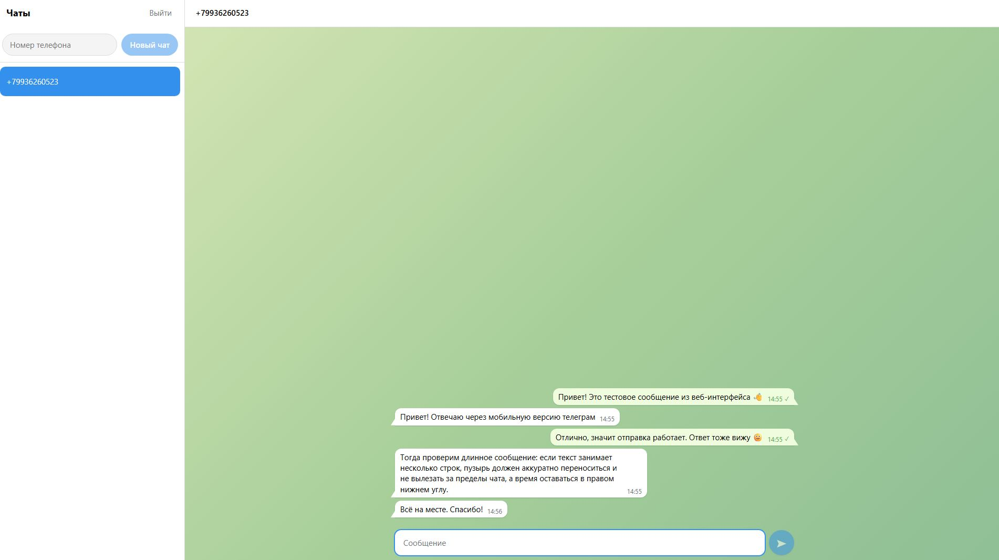

# Green Chat

Веб-интерфейс для отправки и получения сообщений в Telegram через [GREEN-API](https://green-api.com/telegram).

Тестовое задание на позицию «Фронтенд-разработчик React».

**Демо:** https://green-chat-xi.vercel.app/



## Почему Telegram, а не MAX

Я не пользуюсь мессенджером MAX, а задание допускает выполнение для WhatsApp или Telegram. Я выбрала Telegram: у GREEN-API есть отдельный продукт для Telegram с теми же методами (`SendMessage`, `ReceiveNotification`, `DeleteNotification`), поэтому все требования задания выполняются без изменений.

По той же причине прототипом интерфейса взят не web.max.ru, а [Telegram Web](https://web.telegram.org/).

## Возможности

- Вход по учётным данным инстанса GREEN-API (`idInstance`, `apiTokenInstance`) с проверкой, что инстанс авторизован
- Создание чата по номеру телефона с проверкой наличия аккаунта Telegram
- Отправка текстовых сообщений методом `SendMessage` со статусом: отправляется / отправлено / ошибка
- Получение ответов по технологии HTTP API (`ReceiveNotification` + `DeleteNotification`)
- Автопрокрутка к последнему сообщению
- Выход с очисткой сохранённых данных

## Стек

- React + Vite
- SCSS, методология БЭМ, раскладка на CSS Grid
- Без сторонних библиотек: запросы через `fetch`, состояние через `useState`

## Подготовка инстанса GREEN-API

1. Зарегистрируйтесь в [личном кабинете GREEN-API](https://console.green-api.com) и создайте инстанс Telegram (подходит бесплатный тариф Developer).
2. Авторизуйте инстанс: в Telegram на телефоне откройте «Настройки → Устройства → Подключить устройство» и отсканируйте QR-код из личного кабинета.
3. Откройте настройки инстанса («Изменить»):
   - поле **«Адрес отправки уведомлений (URL)»** оставьте **пустым** — иначе получение через HTTP API не работает;
   - включите **«Получать уведомления о входящих сообщениях и файлах»**.
4. Скопируйте из личного кабинета `idInstance`, `apiTokenInstance` и `apiUrl`.

Для проверки понадобится второй аккаунт Telegram, который будет отвечать на сообщения. Чтобы его можно было найти по номеру, добавьте аккаунты друг другу в контакты или разрешите поиск по номеру в настройках приватности.

## Локальный запуск

Нужен Node.js 20 или новее.

```bash
git clone https://github.com/mengmeiying/green-chat.git
cd green-chat
npm install
npm run dev
```

Приложение откроется по адресу http://localhost:5173

Сборка для продакшена:

```bash
npm run build
npm run preview
```

## Как пользоваться

1. Введите `idInstance`, `apiTokenInstance` и `apiUrl` из личного кабинета GREEN-API. Поле `apiUrl` заполнено по умолчанию (`https://4100.api.green-api.com`), но хост у инстансов может отличаться — сверьтесь с личным кабинетом.
2. Введите номер получателя в международном формате (например, `79991234567`; плюс, скобки и пробелы можно оставить — они удаляются автоматически) и нажмите «Новый чат».
3. Напишите сообщение и отправьте его кнопкой или клавишей Enter.
4. Ответьте со второго аккаунта в Telegram — ответ появится в чате.

## Как устроено получение сообщений

Используется long polling по технологии HTTP API:

- `ReceiveNotification` вызывается с `receiveTimeout=20` и ждёт уведомление до 20 секунд; если оно приходит раньше, ответ возвращается сразу;
- после обработки каждое уведомление удаляется через `DeleteNotification` — включая служебные, чтобы они не блокировали очередь;
- цикл запускается в `useEffect` после входа и останавливается через `AbortController` при выходе или размонтировании компонента;
- сообщения дедуплицируются по `idMessage`, поэтому повторно полученное уведомление не создаёт дубль;
- при ошибке сети цикл делает паузу 5 секунд и продолжает работу.

## Структура проекта

```
src/
  api/
    greenApi.js        — все запросы к GREEN-API
  components/
    LoginForm/         — экран входа
    Sidebar/           — список чатов и создание нового
    ChatWindow/        — шапка, лента сообщений, автопрокрутка
    Message/           — одно сообщение
    MessageInput/      — поле ввода
  App.jsx              — состояние приложения, логика входа, отправки и получения
```

## Ограничения

- Показываются только новые сообщения, полученные после входа: загрузка истории не реализована, так как не требовалась в задании.
- Чаты и сообщения хранятся в памяти и пропадают после перезагрузки страницы.
- Учётные данные хранятся в `localStorage`, чтобы не вводить их заново. Для демонстрации это допустимо, в реальном продукте токен не должен храниться на клиенте.
- Отображаются только текстовые сообщения из личных чатов, созданных в приложении. Сообщения из групп и от других отправителей не показываются, чтобы в интерфейс не попадали все чаты подключённого аккаунта.
- Если в очереди инстанса накопились старые уведомления, первые новые сообщения могут прийти с задержкой. Очередь можно очистить в личном кабинете GREEN-API.

## Использование AI

При работе использовала AI-ассистента (Claude) для разбора документации GREEN-API, ревью кода и отладки.